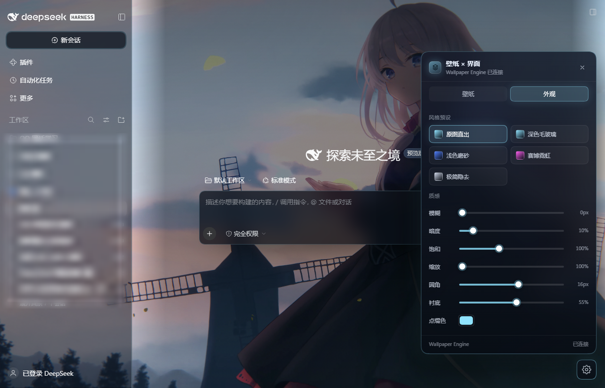
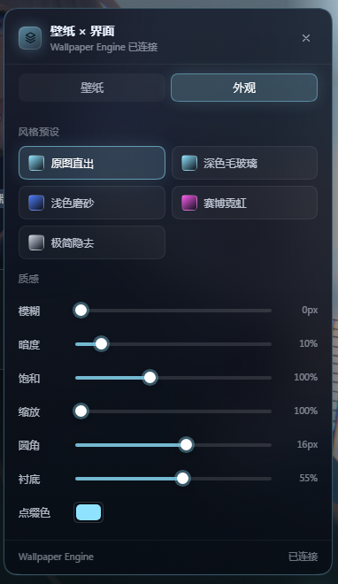

# dsh-wallpaper-glass

把 **Wallpaper Engine 的动态壁纸**变成 DeepSeek Harness 界面的背景，配深色毛玻璃与霓虹描边；墙纸源和界面外观可以分开调，右下角一个齿轮就是全部控制台。

> **English** — A DeepSeek Harness plugin that puts your live Wallpaper Engine wallpaper behind the GUI, turns app surfaces into dark glass with neon accents, and can optionally enable a real Windows acrylic (transparent) window. Windows 10/11, Wallpaper Engine optional.



<p align="center">
  
</p>

---

## 特性

- **真·动态背景**：视频壁纸直接播放（`Range`/`206` 流式传输，可循环、可拖动），WE 换壁纸后界面 5 秒内跟着淡入切换。
- **壁纸与界面分开选**：跟随桌面 / 从已安装壁纸库挑一张只给界面用 / 自定义本地文件，互不影响。
- **深色玻璃界面**：按「面积 + 圆角 + 不透明度 + 是否在弹窗内」运行时判定表面类型，不依赖 CSS Modules 的哈希类名，DSH 升级后大概率不用改。
- **原图直出优先**：默认不加模糊，只压一层可调的「衬底」保证正文可读——想看清晰壁纸不用牺牲可读性。
- **可选的透明窗口**：给 Electron 主进程加 Windows acrylic，桌面动态壁纸真正透过窗口显示（改 `app.asar`，可一键还原）。
- **不联网**：只读本机 Wallpaper Engine 配置，不发送任何数据。

## 环境要求

| 项目 | 要求 |
| --- | --- |
| 系统 | Windows 10 / 11（透明窗口需要 Windows 11 22H2+） |
| DeepSeek Harness | 桌面版（Web GUI 也可用，但没有窗口透明） |
| Node.js | ≥ 18（**仅**安装脚本与透明补丁需要；插件本身跑在 DSH 里） |
| Wallpaper Engine | 可选。不装也能用「自定义图片/视频」当背景 |

## 安装

### 方式 A：一条命令（推荐）

```powershell
git clone https://github.com/MisakaChino/dsh-wallpaper-glass.git
cd dsh-wallpaper-glass
node tools/install.mjs
```

或者直接双击 `scripts\install.cmd`（会自动找 PATH 里的 node，找不到就用 DSH 自带的运行时）。

脚本只做两件事：把本目录以 `link:` 写进你的 profile 依赖，并把条目加进 `dsh.profile.bundles`。**然后重启 DeepSeek Harness**，右下角出现齿轮就成功了。

### 方式 B：手动

1. 把仓库放到 `%USERPROFILE%\.dsh\plugins\dsh-wallpaper-glass`。
2. 编辑 `%USERPROFILE%\.dsh\profiles\<你的 profile>\package.json`：

```jsonc
{
  "dependencies": {
    "dsh-wallpaper-glass": "link:C:/Users/<你>/.dsh/plugins/dsh-wallpaper-glass"
  },
  "dsh": {
    "profile": {
      "bundles": ["@deepseek-ai/dsh-base", "@deepseek-ai/dsh-web-app", "dsh-wallpaper-glass"]
    }
  }
}
```

3. 重启 DSH。

> 只有 `link:` 这一种方式会跟着仓库源码走；`file:` 会拷一份快照，改代码不生效。

## 使用

点界面右下角的 **⚙** 打开面板：

| 分组 | 内容 |
| --- | --- |
| 壁纸 | **跟随桌面**（默认）/ **壁纸库** / **自定义路径**；顶部显示当前壁纸与连接状态 |
| 外观 | 预设：**原图直出**、深色毛玻璃、浅色磨砂、赛博霓虹、极简隐去 |
| 质感 | 模糊、暗度、饱和、缩放、圆角、衬底、点缀色 |
| 行为 | 强制深色玻璃、壁纸柔化、面板毛玻璃、高对比面板、漂浮微粒、播放动态壁纸、透出桌面 |

参数即时生效并写回 `%USERPROFILE%\.dsh\wallpaper-glass\config.json`，刷新页面不会丢。

### 怎么调才好看

| 想要的效果 | 怎么做 |
| --- | --- |
| 壁纸原样、锐利 | 预设「原图直出」，模糊保持 0 |
| 正文压不住字、想更清楚 | 把「衬底」拉到 0.6–1.0（只压正文那一竖条） |
| 完全露出壁纸 | 「衬底」拉到 0 |
| 小字/图标仍偏灰 | 打开「高对比面板」，或把「暗度」加到 0.25+ |
| 轻微微糊一点 | 「壁纸柔化」开关，或模糊 3–10px |

### 可选的桌面透明窗口

让 Windows 桌面壁纸真正透过 DSH 窗口显示，需要给 Electron 主进程加 `backgroundMaterial: "acrylic"`：

```powershell
npm run glass:status   # 只读检查：当前是否已打补丁
npm run glass:on       # 关闭 DSH → 备份 → 打补丁并校验 → 重启
npm run glass:off      # 关闭 DSH → 用备份还原 → 重启
```

也可以双击 `scripts\enable-desktop-glass.cmd` / `disable-desktop-glass.cmd`。

打完补丁后在面板「外观 → 行为」勾选 **透出桌面（透明窗口）**。

它是怎么保证安全的：

1. 先在临时文件里生成补丁后的归档，**逐字节校验** 2 万多个条目、`lib/main.js` 语法、integrity 哈希；
2. 校验全过才写一份 `app.asar.bak-<时间戳>`；
3. 最后原子替换，任何一步失败都不会动原文件，`revert` 也永远不删备份。

> DSH 每次更新都会覆盖 `app.asar`，更新后重新 `glass:on` 即可。这一步与插件本体无关，纯属锦上添花——不打补丁也能用内置壁纸层。

## 面板背后的判定规则（想改代码可以看）

这些规则都是踩坑换来的，写下来给后来人省点时间：

- **整高容器不能加 `backdrop-filter`**：桌面窗口的 `_centerCol` 是 1002×782（95% 高）的带底色容器，给它加模糊会把**整张壁纸**糊掉。所以毛玻璃必须同时满足「面积 < 18%、高度 < 55%」。
- **毛玻璃只给界面面板，不给消息卡片**：对话里的代码块/工具卡片是 800px 宽的横条，一张接一张铺满正文，每张都模糊就等于全屏模糊。判断「输入框」靠的是**里面有没有编辑器**（`[contenteditable="true"]` / `textarea`），按位置判断不可靠。
- **弹窗内部一律不碰**：设置页里可能装着别家插件的界面（插件市场等），那些卡片属于插件自己。规则是「整屏 + `position: fixed` + 不含正文栏 = 弹窗层」，只给外壳上玻璃，壳内全部跳过。
- **两种遮罩要分清**：侧栏底部 264×24 的渐隐条（透明色渐变）必须清掉，否则列表下方一条黑边；但弹窗背后的全屏 dim mask 写法相同，清掉会让弹窗"变透明"。只清**高度 ≤ 220px** 的短条。
- **布局列要贴住上下边缘**，但桌面窗口顶上有 40px 原生标题栏，阈值要用 `top <= 48` 而不是 `<= 8`。
- **毛玻璃面板要更深的底色**（比普通面板多 0.22 不透明度）：亮壁纸 + 50% 底色 + 18px 模糊会把磨砂冲成浅灰，浅色文字对比度只剩 1.3:1。
- **矮工具条**（页签条/工具栏，高度 ≤ 96、宽度 ≥ 80）面积常常不到视口 2%，会撞上面积门槛，所以它们单独绕过门槛并走更实的 `--wg-surface-chrome`（0.70）。
- **深色玻璃下提亮次级文字**：`--dsw-alias-label-secondary` 从 ~55% 提到 92%，否则图标按钮那圈灰压在亮壁纸上几乎看不见。

## 目录结构

```
dsh-wallpaper-glass/
├─ lib/
│  ├─ index.js           # 宿主端：WE 发现、媒体流、配置持久化、HTTP 路由
│  └─ client.js          # 客户端：背景层、玻璃化、控制面板
├─ tools/
│  ├─ install.mjs        # 写入 profile（link: + bundles）
│  ├─ transparency.mjs   # 透明窗口的一键开关（关应用→打补丁→重启）
│  ├─ asar-patch.mjs     # 可逆、带校验的 app.asar 补丁器
│  └─ find-dsh.mjs       # 定位安装目录（不写死盘符）
├─ scripts/              # 给不习惯命令行的 Windows 用户的双击脚本
├─ docs/                 # 截图
└─ cordis.patch.yml      # bundle 声明
```

## 常见问题

**改了代码没生效？**
DSH 桌面版没有绑定 `Ctrl+R`。在「设置 → 插件」里把本插件关掉再打开即可热重载（宿主端代码会重读，页面也会重新拉 bundle）。

**壁纸库是空的 / 少了壁纸？**
只列**真能用的**壁纸：有独立视频文件或本身就是图片。`scene.pkg`、网页、程序类壁纸浏览器渲染不了，会直接从库里隐掉，面板底部会写明「已隐藏 N 个」。

**侧栏底部有条黑边？**
已在 v0.1.0 修复（识别 264×24 的渐隐遮罩）。若仍出现，说明 DSH 换了类名，把截图提到 issue。

**弹窗变透明了？**
说明它被误判成普通面板。请附上 DSH 版本号 + 截图；判定逻辑在 `lib/client.js` 的 `sweepSurfaces()`。

**透明窗口报错 / 打不开？**
确认系统是 Windows 11 22H2+，且已关闭 DSH 再执行（脚本会自动关）。失败时原 `app.asar` 不会被修改，直接 `glass:off` 还原。

## 卸载

```powershell
node tools/install.mjs --remove   # 从 profile 移除
```

然后删除仓库目录，并（可选）删掉 `%USERPROFILE%\.dsh\wallpaper-glass\`。如果打过透明补丁，先 `npm run glass:off`。

## 隐私

插件不发起任何外部网络请求。它读取的数据只有：Wallpaper Engine 的本地配置与壁纸文件、DSH 自己的 profile 配置。媒体通过本机 `127.0.0.1` 的 DSH 端口提供给页面。

## 许可

[MIT](LICENSE)。与 DeepSeek、Wallpaper Engine 均无隶属关系；Wallpaper Engine 及其壁纸版权归各自作者所有，本仓库只读取你本机已购买/已安装的内容。
